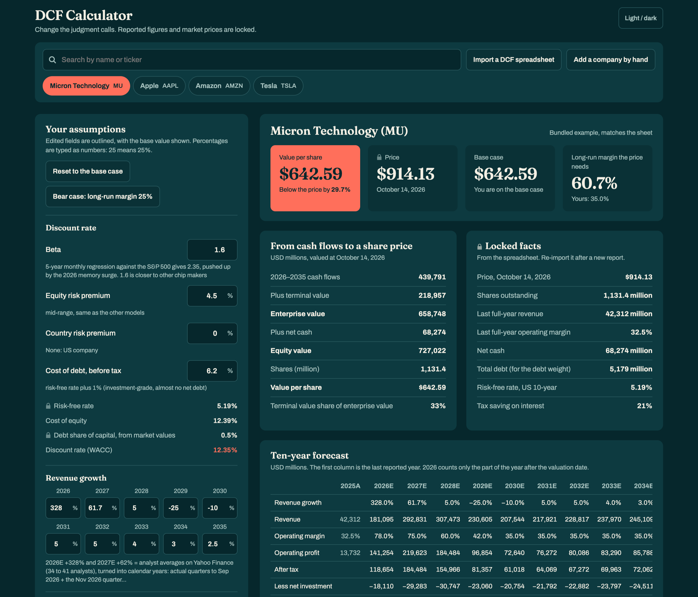

# DCF Calculator

**A DCF you can actually read.** Same math as the spreadsheet, without the wall of grey cells.

**[Try it live →](https://zi-cong-tan.github.io/DCF-Calculator-Aesthetic/)**

## Why this exists

Most DCF models live in Excel templates: hundreds of cells, tiny fonts, blue-for-input and black-for-formula, and a value per share buried somewhere around row 60. You can build them, but it's hard to *show* one to anyone. In a pitch or a meeting, people want to know three things: what is it worth, how does that compare to the price, and what would have to be true for the price to make sense.

This calculator puts those answers first.

- **The answer is at the top.** Value per share, the market price, and how far apart they are, in large type the second the page opens.
- **Only the judgment calls are editable.** Reported figures and market prices are locked, so nobody "fixes" the revenue by accident. Growth, margins, discount rate and terminal assumptions are the knobs, each with a note on where the number came from.
- **Every step is spelled out.** Cash flows, plus terminal value, gives enterprise value; less net debt gives equity value; divided by shares gives the price. One clean list, not a chain of cell references.
- **It answers "what does the price assume?"** It works out the long-run margin the market price needs, so a debate about whether a stock is cheap becomes a debate about one number.
- **Stress-testing takes one click.** A bear case button, a reset button, and a sensitivity grid that marks the cell nearest today's price.
- **It looks good on a projector.** Dark and light themes, clear type, nothing to squint at.

Nothing is lost in the translation. The four bundled models match their source spreadsheets to the cent, and you can import any workbook built on the same template. [Open it in your browser](https://zi-cong-tan.github.io/DCF-Calculator-Aesthetic/); there's nothing to install.

## What's inside

- `index.html`: the calculator. Four models come bundled: Micron, Apple, Amazon and Tesla. Their values match the spreadsheets to the cent.
- `examples/`: the four source workbooks, built from SEC filings and analyst estimates as of 14 Oct 2026. Every input has a note on where it came from. Use any of them as the template for your own company.

## The model

- Ten-year forecast with mid-year discounting and a part-year for 2026
- Terminal value where reinvestment = growth ÷ return on capital
- A bear-case button and reset-to-base

## How to use

1. **Open it.** Go to **[zi-cong-tan.github.io/DCF-Calculator-Aesthetic/](https://zi-cong-tan.github.io/DCF-Calculator-Aesthetic/)**. Nothing to install or sign up for. (To use it offline, click the green **Code** button above, choose **Download ZIP**, and double-click `index.html`.)
2. **Pick a company.** Click one of the four worked examples under the search bar, or search **any S&P 500 company** by name or ticker. A searched company loads its reported figures from SEC filings and the last closing price, updated every weeknight. Its assumptions start as defaults from its own history (past growth, average margin, average reinvestment, a blended beta), so set them before trusting the value.
3. **Read the answer.** The top row shows the value per share, the market price, and the long-run margin the price needs.
4. **Change the assumptions.** Edit any box on the left. Percentages are typed as plain numbers (25 means 25%). Edited boxes are outlined and show the base value, and everything on the right updates as you type.
5. **Stress-test it.** Click **Bear case** for a pessimistic version, or check the sensitivity grid to see the value across different discount rates and margins. **Reset to the base case** puts everything back.
6. **Add your own company.**
   - **Import a DCF spreadsheet:** any `.xlsx` built on the same template. Copy one of the files in `examples/` and fill in your company.
   - **Add a company by hand:** enter the reported figures from the latest annual report. The starting assumptions are placeholders, so change them before trusting the value.

## Where your work is saved

Everything runs inside your own browser. There is no server and no account, and nothing you type or import is uploaded anywhere.

- Companies you add and assumptions you change are saved in **your** browser on **your** computer.
- If two people use it at the same time, each has their own copy and neither can see or change the other's work.
- Your saved work doesn't follow you to another browser or device, and clearing your browser data erases it. Keep the spreadsheet if you want a permanent copy.

## Notes

**Company data.** `tools/build_data.py` pulls every S&P 500 company's 10-K and 10-Q figures from the SEC, the last close and five years of monthly prices (for beta), and the US 10-year Treasury yield. It writes `data/index.json` and one file per company in `data/co/`. A GitHub Action (`.github/workflows/data.yml`) runs it every weeknight after the US close; browsers cannot call the SEC directly, so the site reads these saved files. Banks and other companies without reported operating income are skipped, as an operating cash flow DCF does not fit them.

**Running it yourself.** The SEC asks every request to name a contact email. Locally: `SEC_CONTACT=you@example.com python3 tools/build_data.py` (add tickers to rebuild only those). For your own fork's nightly run, add a repository secret named `SEC_CONTACT` (Settings → Secrets and variables → Actions). The email is sent only to the SEC and never saved in the repo.

Prices and the risk-free rate are as of mid-October 2026. This is a learning and analysis tool, not investment advice.

## Updates

**October 19, 2026 (evening)**: **search any S&P 500 company.** Reported figures come from SEC filings and the last close, refreshed every weeknight by a GitHub Action. Starting assumptions come from each company's own history and are labelled as defaults.

**October 19, 2026 (later)**: the page now follows the standard DCF order, based on feedback from LinkedIn:
- **The answer stays on top**, then four numbered steps: revenue to unlevered free cash flow (with a steady-state terminal column), the discount rate build, the terminal value, and enterprise value to value per share.
- **History from SEC filings.** Revenue, operating margin, capex, D&A and the change in working capital for the last three fiscal years, taken straight from each 10-K. Use it to check the reinvestment assumption.
- **One average growth rate.** A button that spreads the same ten-year revenue growth evenly across all years. Reset undoes it.

**October 19, 2026**: changes based on feedback from r/financialmodelling:
- **Blended betas.** Each beta is now 0.67 × the 5-year regression beta + 0.33, instead of a judgment call. Values moved: Micron $642.59 → $589.64, Apple $148.68 → $151.20, Amazon $139.85 → $136.19, Tesla $22.97 → $26.39.
- **Discount rate the price implies.** Shows the rate at which the value equals today's price, next to your own discount rate.
- **Second sensitivity grid.** Shows the discount rate against terminal growth.

## Feedback welcome

This is my first project on GitHub, so I'd love to hear what you think. Ideas for making the calculator better, things that confused you, features you'd want, or suggestions for what I should build next are all welcome.

[Open an issue](https://github.com/zi-cong-tan/DCF-Calculator-Aesthetic/issues/new) or message me on LinkedIn.

## Author

Built by Zi Cong Tan, MS Finance (Quantitative Finance with AI) student. The valuation models, assumptions and research are my own; the interface was built with Claude Code.

Connect on [LinkedIn](https://www.linkedin.com/in/tanzicong) or [Instagram](https://www.instagram.com/cong_zee/).
